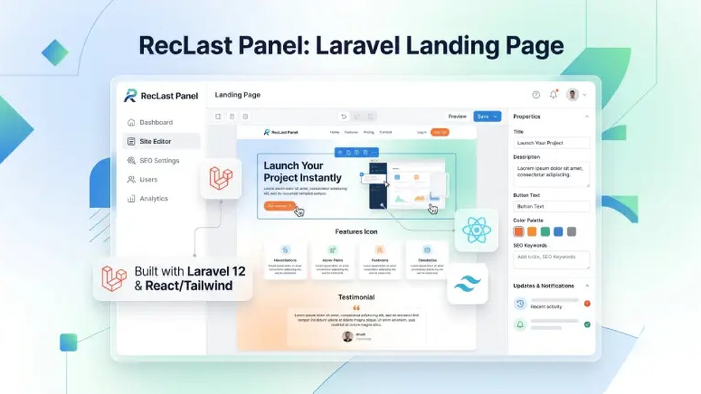
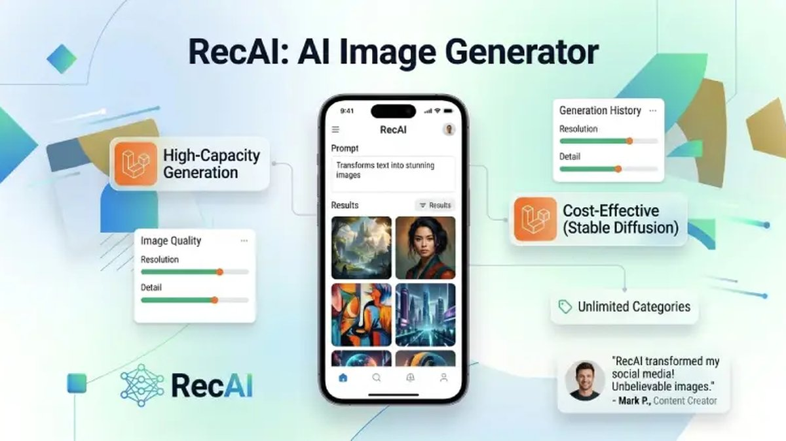
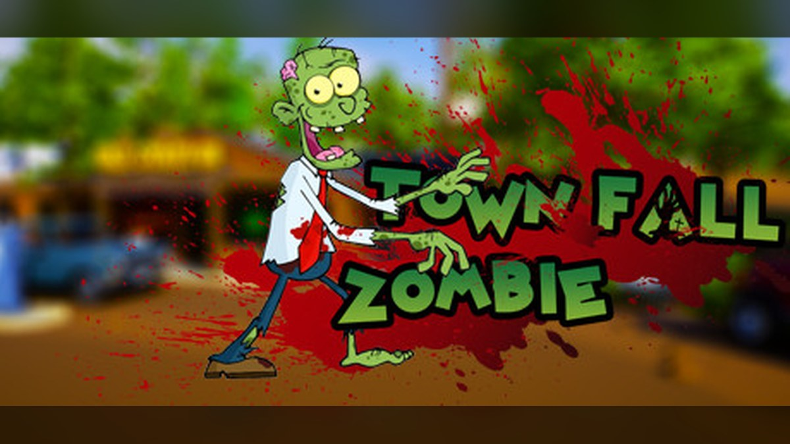
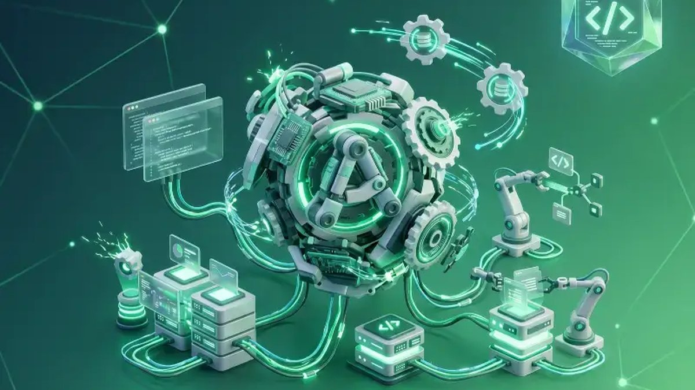

<!-- ───────────────────────── HEADER ───────────────────────── -->
<p align="center">
  
</p>

<p align="center">
  <a href="https://umiteski.com.tr/">
    
  </a>
</p>

<p align="center">
  <a href="https://umiteski.com.tr/"></a>
  <a href="https://www.linkedin.com/in/umiteskiue/"></a>
  <a href="https://x.com/RecLastTV"></a>
  <a href="https://blog.umiteski.com.tr/"></a>
  <a href="https://umiteski.com.tr/contact"></a>
</p>

---

### 👋 About me

```php
<?php

final class UmitEski extends Developer
{
    public string $role     = 'Full-Stack Web & Mobile Developer';
    public string $company  = 'Founder @ UmitEski Studio';
    public string $location = 'Ankara / Zonguldak, Türkiye';

    public array $builds = [
        'web'    => ['Laravel', 'Inertia', 'React', 'TypeScript', 'Tailwind CSS'],
        'mobile' => ['Flutter', 'Dart'],
        'ai'     => [
            'Cloudflare Workers AI', 'LLM integrations', 'Stable Diffusion / Flux',
            'AI video generation', 'AI agents & automation bots', 'Prompt engineering',
        ],
        'infra'  => ['Docker', 'Coolify', 'Hetzner', 'MySQL', 'Redis'],
    ];

    public array $background = [
        'Game design & development (Unity, Unreal Engine)',
        'Video editing & content creation',
    ];

    public array $tools = [
        'Cursor', 'VS Code', 'Grok Bot', 'Antigravity', 'Gemini',
        'Photoshop', 'Premiere Pro', 'After Effects', 'ArtCraft',
        'Laravel Herd', 'OBS', 'Notion',
    ];

    public array $workflow = [
        'Vibe-coding with Cursor, Grok Bot & Gemini',
        'Ship fast, keep it clean',
    ];

    public function philosophy(): string
    {
        return 'Modular, clean and fast — and I write my own admin panels.';
    }
}
```

- 🚀 I build **web products, mobile apps and AI-powered tools** end to end — from backend and admin panel to UI and deployment.
- 🧩 Currently focused on **RecLast Panel**, my own Laravel-based CMS with a theme system, and on **AI products** like **RecAI**.
- 🎮 Long background in **game development** and **video content** — which is why I care a lot about UX, visuals and performance.
- 💼 Open to freelance projects: websites, custom software, mobile apps, AI integrations. → [Get a quote](https://umiteski.com.tr/get-quote)

---

### 🌟 Featured work

<table>
  <tr>
    <td width="50%" valign="top">
      <a href="https://umiteski.com.tr/products/reclast-panel-laravel-landing-page"></a>
      <h3>🧱 RecLast Panel</h3>
      <p>A fast, secure, <b>WordPress-like admin panel built from scratch on Laravel</b>. Enter a company name and sector and a ready theme is generated; the theme system lets a completely different site be built just by writing a theme. Ships with its own licensing &amp; update system.</p>
      <p><b>Ready editions:</b> <a href="https://umiteski.com.tr/products/reclast-panel-laravel-landing-page">Landing</a> · <a href="https://umiteski.com.tr/products/reclast-panel-laravel-corporate-site">Corporate</a> · <a href="https://umiteski.com.tr/products/panel-laravel-freelance-agency-system">Agency</a> — <i>more editions on the way.</i></p>
      <p>
        
        
        
        
        
      </p>
      <a href="https://umiteski.com.tr/products"></a>
    </td>
    <td width="50%" valign="top">
      <a href="https://play.google.com/store/apps/details?id=com.umiteski.recai"></a>
      <h3>🎨 RecAI</h3>
      <p>A <b>free AI image generator</b> for Android that turns text into images — no sign-up required. Built end to end by me, from the serverless AI backend to the mobile UI.</p>
      <ul>
        <li>Flutter mobile app</li>
        <li>Stable Diffusion models on Cloudflare Workers AI</li>
        <li>Free, no account needed</li>
      </ul>
      <p>
        
        
        
      </p>
      <a href="https://play.google.com/store/apps/details?id=com.umiteski.recai"></a>
      <a href="https://umiteski.com.tr/products/recai-ai-image-generator"></a>
    </td>
  </tr>
  <tr>
    <td width="50%" valign="top">
      <a href="https://store.steampowered.com/app/1447730/Town_Fall_Zombie/"></a>
      <h3>🧟 Town Fall Zombie</h3>
      <p>An <b>open-world zombie simulation game</b> on Steam, published by <b>UmitEski Studio</b>. Roam the town, drive, fight — or turn the whole city into zombies and wreak havoc. Started with an indie team and finished solo.</p>
      <p>
        
        
        
      </p>
      <a href="https://store.steampowered.com/app/1447730/Town_Fall_Zombie/"></a>
    </td>
    <td width="50%" valign="top">
      <a href="https://umiteski.com.tr/services/automation-bots"></a>
      <h3>🤖 Automation Bots</h3>
      <p><b>AI-powered bots and agents</b> that take repetitive work off the table: content pipelines, mail handling, daily operations and site monitoring — each bot owns its job and reports back.</p>
      <ul>
        <li>LLM-driven content &amp; mail workflows</li>
        <li>Scheduled ops, backups and uptime / SSL monitoring</li>
        <li>n8n / Make workflows and custom scripts</li>
      </ul>
      <p>
        
        
        
        
      </p>
      <a href="https://umiteski.com.tr/services/automation-bots"></a>
    </td>
  </tr>
</table>

---

### 🧠 AI & automation

<p>
  
  
  
  
  
  
  
  
</p>

- 🤖 **AI-powered products** — RecAI (text-to-image) and an open-source [Workers AI API gateway](https://github.com/RecLast/aireclast) for text, image and code generation.
- 🔗 **LLM integrations** into Laravel & React apps: content generation, assistants, smart admin features.
- 🎬 **AI image & video generation** for content and marketing.
- 🧩 **Agents & automation** — multi-bot setups that handle content, mail and daily ops on their own.
- ⚡ **Vibe-coding** with Cursor, Grok Bot, Gemini and Antigravity to ship faster without losing code quality.

---

### 🛠️ Tech stack

<p align="center"><b>Web & Backend</b><br/>
  
</p>
<p align="center"><b>Mobile, Desktop & AI</b><br/>
  
</p>
<p align="center"><b>Data, DevOps & Tools</b><br/>
  
  <br/>
  
  
  
</p>
<p align="center"><b>Game Dev & Design</b><br/>
  
</p>

---

### 📈 GitHub activity

<p align="center">
  
  
</p>
<p align="center">
  
</p>

<!-- Snake (enable after .github/workflows/snake.yml has run once and created the "output" branch):
<p align="center">
  <picture>
    <source media="(prefers-color-scheme: dark)" srcset="https://raw.githubusercontent.com/RecLast/RecLast/output/github-contribution-grid-snake-dark.svg"/>
    
  </picture>
</p>
-->

---

### 💼 Experience

Freelance developer & founder of **UmitEski Studio** · previously Android developer (URAS Gamification Platform), co-founder & game designer (Codexcited), game designer (Fatalitech), video editor (DijitalHoca).
Full history → [LinkedIn](https://www.linkedin.com/in/umiteskiue/)

### 📺 Content

<p>
  <a href="https://www.youtube.com/@RecLastTVOfficial"></a>
  <a href="https://www.youtube.com/@UmitEskiUE"></a>
  <a href="https://www.twitch.tv/RecLastTV"></a>
  <a href="https://medium.com/@umiteski"></a>
  <a href="https://www.instagram.com/umiteskiue/"></a>
</p>

<p align="center">
  
</p>
